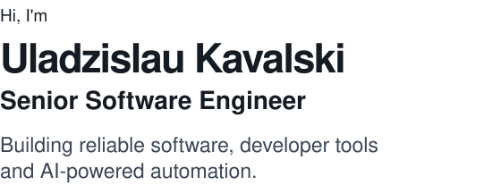
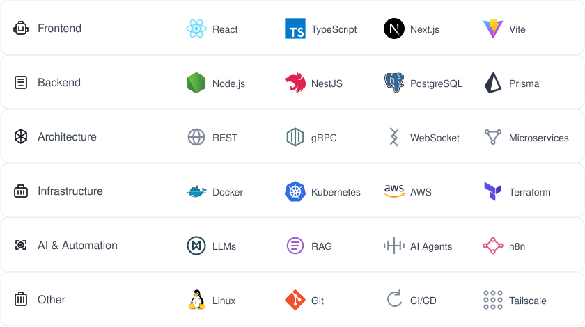
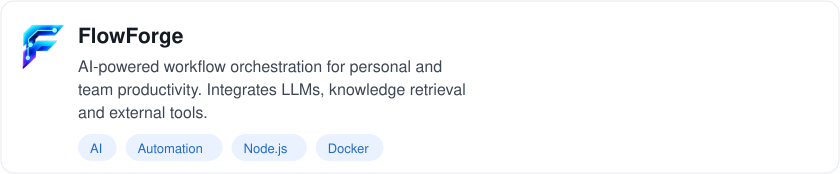

<!-- Minimal / Linear · v2 · matched to the supplied reference -->

<picture>
  <source media="(max-width: 600px) and (prefers-color-scheme: dark)" srcset="assets/hero-mobile-dark.svg">
  <source media="(max-width: 600px) and (prefers-color-scheme: light)" srcset="assets/hero-mobile-light.svg">
  <source media="(prefers-color-scheme: dark)" srcset="assets/hero-dark.svg">
  
</picture>

[<picture>  <source media="(prefers-color-scheme: dark)" srcset="assets/contact-linkedin-dark.svg">  </picture> LinkedIn](https://www.linkedin.com/in/uladzislau-kavalski-5b00aa68) &nbsp; &nbsp; [<picture>  <source media="(prefers-color-scheme: dark)" srcset="assets/contact-email-dark.svg">  </picture> Email](mailto:vladislav.kovalskij@gmail.com) &nbsp; &nbsp; [<picture>  <source media="(prefers-color-scheme: dark)" srcset="assets/contact-github-dark.svg">  </picture> GitHub](https://github.com/zmzm)

 

### — &nbsp; About Me

I'm a software engineer with **9+ years of experience** building web applications
and backend systems. My background is primarily in frontend engineering, but over
the years I've increasingly worked on system architecture, backend services
and complex integrations.

I enjoy solving challenging engineering problems, designing reliable systems
and experimenting with **AI Agents, automation and self-hosted infrastructure**.

 

### <picture>  <source media="(prefers-color-scheme: dark)" srcset="assets/section-tech-dark.svg">  </picture> &nbsp; Tech Stack

<picture>
  <source media="(max-width: 600px) and (prefers-color-scheme: dark)" srcset="assets/tech-stack-mobile-dark.svg">
  <source media="(max-width: 600px) and (prefers-color-scheme: light)" srcset="assets/tech-stack-mobile-light.svg">
  <source media="(prefers-color-scheme: dark)" srcset="assets/tech-stack-dark.svg">
  
</picture>

### <picture>  <source media="(prefers-color-scheme: dark)" srcset="assets/section-projects-dark.svg">  </picture> &nbsp; Featured Projects

<picture>
  <source media="(max-width: 600px) and (prefers-color-scheme: dark)" srcset="assets/project-flowforge-mobile-dark.svg">
  <source media="(max-width: 600px) and (prefers-color-scheme: light)" srcset="assets/project-flowforge-mobile-light.svg">
  <source media="(prefers-color-scheme: dark)" srcset="assets/project-flowforge-dark.svg">
  
</picture>

<picture>
  <source media="(max-width: 600px) and (prefers-color-scheme: dark)" srcset="assets/project-pentagon-homelab-mobile-dark.svg">
  <source media="(max-width: 600px) and (prefers-color-scheme: light)" srcset="assets/project-pentagon-homelab-mobile-light.svg">
  <source media="(prefers-color-scheme: dark)" srcset="assets/project-pentagon-homelab-dark.svg">
  
</picture>

[View Pentagon Homelab ↗](https://github.com/zmzm/pentagon-homelab)

<picture>
  <source media="(max-width: 600px) and (prefers-color-scheme: dark)" srcset="assets/project-knowledge-router-mobile-dark.svg">
  <source media="(max-width: 600px) and (prefers-color-scheme: light)" srcset="assets/project-knowledge-router-mobile-light.svg">
  <source media="(prefers-color-scheme: dark)" srcset="assets/project-knowledge-router-dark.svg">
  
</picture>

### <picture>  <source media="(prefers-color-scheme: dark)" srcset="assets/section-exploring-dark.svg">  </picture> &nbsp; Currently Exploring

→ &nbsp; Multi-agent systems and orchestration  
→ &nbsp; AI-assisted software development  
→ &nbsp; Knowledge retrieval & context engineering  
→ &nbsp; Self-hosted infrastructure  
→ &nbsp; Better developer experience
